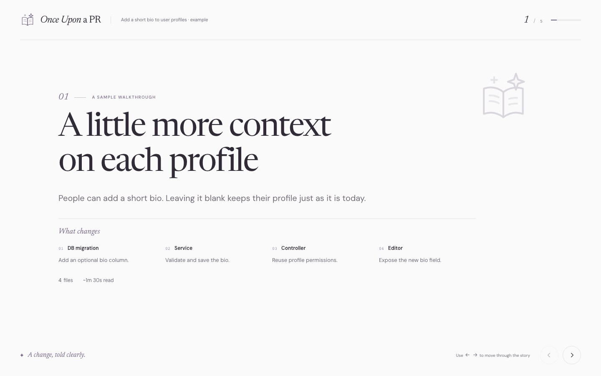

# Once Upon a PR 🧚

Interactive MR/PR walkthrough deck generator.

Understand a pull request the way you would if a colleague walked you through it: why the change exists, the important decisions, and the code that makes them work.

`once-upon-a-pr` is a portable coding-agent skill that creates a short, interactive HTML deck from a GitHub PR or GitLab MR. Editorial typography, a quiet storybook identity, focused diffs, and explanations beside the code. Natural writing, with the length and shape chosen for the change.

The opening introduces the intent and the areas touched, such as the database, service, and controller. The closing keeps a single large button back to the pull request.



### Sample deck

- [`sample.html`](.claude/skills/once-upon-a-pr/assets/deck-template/sample.html) — an illustrative, five-slide profile-bio walkthrough. Open it locally to explore the format.

Run it on your own MR to get one of these.

## Install

For **Claude Code**, copy `.claude/skills/once-upon-a-pr/` and `.claude/commands/once-upon-a-pr.md` into the matching paths in your repository.

```
your-repo/
  .claude/
    commands/once-upon-a-pr.md
    skills/once-upon-a-pr/
      SKILL.md
      references/
      assets/deck-template/
```

For **Codex**, copy `.agents/skills/once-upon-a-pr/` into your repository's `.agents/skills/` directory.

For other agents that support `SKILL.md`, install the skill folder in their skill location. The instructions use paths relative to the skill and do not require agent-specific delegation tools.

The bundled runner uses Node.js built-ins plus authenticated `gh` or `glab`. There is no package installation for generating or viewing decks. The HTML and its local assets work offline once generated.

## Usage

In Claude Code:

```
/once-upon-a-pr
/once-upon-a-pr https://gitlab.com/yourorg/yourrepo/-/merge_requests/1234
/once-upon-a-pr feature/notifications
/once-upon-a-pr --dry-run
```

In Codex or another skill-aware agent, ask to use `once-upon-a-pr` with a PR URL or the current branch.

- No arg → current branch's open MR.
- `--dry-run` → stop after the narrative outline, print, exit.

Deck lands at `docs/once-upon-a-pr/<slug>/<slug>.html` (slug = `<mr-id>-<title-slug>`). Commit, push, and MR comments happen only after explicit confirmation.

## What it does

1. Reads the PR context and indexes the diff.
2. Chooses a concise story about the problem and the important changes.
3. Pairs focused diff excerpts with clear explanations.
4. Checks the slide data and annotation anchors, then builds the local HTML deck.

The agent makes the editorial decisions. The runner handles repeatable mechanics and checks that annotations refer to the right code. There are no enforced word counts, slide quotas, or required risk/skipped slides.

## Customize

- `references/heuristics.md` — cues for choosing what deserves attention.
- `references/narrative-patterns.md` — adjust voice and slide archetypes.
- `assets/deck-template/` — edit the look.

## Development

From `scripts/`, run `npm test` for the runner checks. The optional browser checks use the Playwright development dependency: `npm install`, `npx playwright install chromium`, then `npm run test:browser`.

Run `npm run sample` to regenerate both bundled samples from the illustrative fixture. Generated decks in `docs/once-upon-a-pr/` are historical examples; the bundled sample shows the current design.
