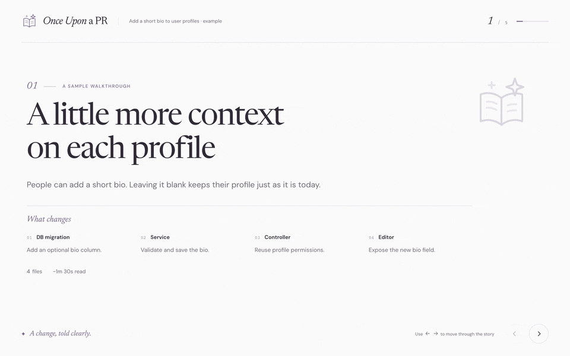

# tell-me-a-pr — drop-in for Claude Code

Interactive MR/PR walkthrough deck generator.

> AI ships bigger PRs. GitHub still hands the reviewer a flat diff. **`tell-me-a-pr`** turns the diff into a short narrated deck — so a reviewer lands on the *intent* and the *risky bits* before the line-by-line work.



### Sample decks

- [`sample.html`](.claude/skills/tell-me-a-pr/assets/deck-template/sample.html) — small change (4 files, "add a bio field"). Quick look at the format.
- [`sample-rate-limit.html`](.claude/skills/tell-me-a-pr/assets/deck-template/sample-rate-limit.html) — realistic 12-file feature: Redis primitive → middleware → 3 routes → frontend cooldown → Datadog alert → tests. The kind of PR `tell-me-a-pr` is built for.

Run it on your own MR to get one of these.

## Install

Copy the `.claude/` folder into the root of any repo:

```
your-repo/
  .claude/
    commands/tell-me-a-pr.md
    skills/tell-me-a-pr/
      SKILL.md
      references/
      assets/deck-template/
```

No dependencies to install for the skill itself. At runtime, Claude Code will use whatever is available in the host repo:
- `glab` or `gh` for the MR platform

## Usage

In Claude Code:

```
/tell-me-a-pr
/tell-me-a-pr https://gitlab.com/yourorg/yourrepo/-/merge_requests/1234
/tell-me-a-pr feature/notifications
/tell-me-a-pr --dry-run
```

- No arg → current branch's open MR.
- `--dry-run` → stop after the narrative outline, print, exit.

Deck lands at `docs/tell-me-a-pr/<mr-id>/`, gets committed and pushed, and a link is posted on the MR.

## What it does

1. Fetches the MR (GitLab or GitHub, abstracted).
2. Analyzes the diff with heuristics + LLM reasoning to find must-shows and interesting windows.
3. Architects an adaptive narrative (4–14 slides depending on MR complexity).
4. Curates code windows and writes reviewer-addressed narration.
5. Builds a self-contained HTML deck from the template.
6. Commits, pushes, posts a comment on the MR.

Every heavy phase runs in a Task subagent so the orchestrator's context stays lean.

## Customize

- `references/heuristics.md` — tune the must-show patterns per your team's conventions.
- `references/narrative-patterns.md` — adjust voice and slide archetypes.
- `assets/deck-template/` — edit the look.
